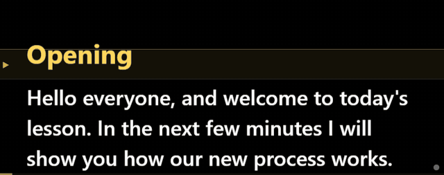
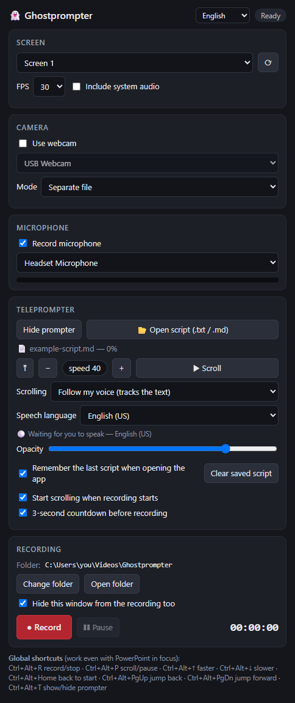

# Ghostprompter

*A free, offline teleprompter that follows your voice and records your screen, webcam and microphone — made for
lectures and presentations.*

**English** · [Português](#português) · [Español](#español)

  
   <em>"Follow my voice": the script scrolls with your speech, offline. Words already read are dimmed; cues like (next slide) are skipped.</em>

Ghostprompter records **screen + webcam + microphone** and shows a **floating teleprompter that is kept out of the
recording** (see the limits in *Teleprompter kept out of the recording*, below).

## Purpose and responsible use

**What it is for:** recording **lectures, presentations and explainer videos** on your own, with good quality — free,
no account, no subscription, no hassle. The teleprompter is hidden from the recording so that **the people watching
your video** see you speaking naturally, without the script on screen.

**What it is NOT for:** Ghostprompter **was not made to cheat** in job selection processes, interviews, exams,
assessments, thesis defenses, proctoring/monitoring systems or any situation where reading hidden text is forbidden
or deceives someone. Do not use it for that.

**What it does not do:**
- it **does not connect to external sources**: no internet content, no artificial intelligence, chatbots,
  assistants, MCP or any online service, no real-time text feed, and it cannot be controlled remotely;
- it **only shows the script you opened yourself** (a `.txt` or `.md` file on your computer);
- it **sends nothing** off your computer. The only internet access is downloading speech-recognition models when you
  ask (see [PRIVACY.md](PRIVACY.md)).

**Your responsibility:** use the app lawfully and according to the rules where you record. Recording other people
may require their consent. The software is provided "as is", without warranty.

## Install (Windows)
Download the installer **only from this project's [Releases page](https://github.com/luisbei/ghostprompter/releases)**,
check the SHA-256 published there (`Get-FileHash <file>` in PowerShell) and follow the wizard. It creates Start menu
and desktop shortcuts and shows up in "Add or remove programs". Speech models are downloaded by the app itself when
you choose "Follow my voice".

The installer is not digitally signed yet ([CODE_SIGNING.md](CODE_SIGNING.md)), so Windows may show "Windows
protected your PC". After checking where the file came from, click **More info → Run anyway**. If your antivirus
blocks it, see [`docs/LEIA-ME.txt`](docs/LEIA-ME.txt) (never create exclusions for whole folders).

Uninstalling does **not** delete your recordings or settings. To delete settings and speech models, remove
`%LOCALAPPDATA%\Ghostprompter`.

## How to use

1. **Screen**: choose the screen (or window) to record. Tick "Include system audio" to record the computer's sound.
2. **Camera / Microphone**: choose your devices. The bar shows the microphone level. Camera **Mode**:
   - *Separate file* — records `camera.mp4` separately (best for editing later).
   - *On-screen window* — shows a floating webcam window (circle or rectangle) over the screen; it **appears in the
     screen video**. Drag to move; pull the corner or use the mouse wheel to resize.
   - *Both* — on-screen window and the separate file.
3. **Teleprompter**: click *Open script* or **drag a `.txt`/`.md` file** onto the black window.
   - Drag the top bar (shown on hover) to move it and pull the edges to resize — place it near your webcam.
   - Position and size are remembered.
4. **● Record**. With the countdown on, the prompter shows 3‑2‑1 and starts scrolling by itself.

### Teleprompter kept out of the recording: how it works and its limits
The teleprompter (and, if ticked, the control panel) uses Windows capture protection (`WDA_EXCLUDEFROMCAPTURE`,
Windows 10 version 2004 or newer). You see the text on screen, but it is left out of Ghostprompter's recording and,
in general, of other recording and screen-sharing programs that honor this protection.

**It is not a universal guarantee:** it depends on Windows and on each program's capture method, and it does not hide
anything from a camera or phone pointed at the screen, nor from external capture of the video signal. **Make a test
recording** before relying on it. (Remember: the purpose is recording lectures and presentations — see *Purpose and
responsible use*.)

### Recorded files
By default in `Videos\Ghostprompter\Recording <date>\`. Names follow the interface language
(e.g. `Gravacao …\tela.mp4` in Portuguese, `Grabacion …\pantalla.mp4` in Spanish):
- `screen.mp4` — screen + microphone (+ system audio, if ticked)
- `camera.mp4` — webcam + microphone (same audio, easy to sync when editing) — in *Separate file* and *Both* modes

Videos are recorded directly as **MP4 (H.264 + AAC)** by the app itself, with no external programs. Only folders on
this computer are accepted (network folders are refused), and the app warns you if the folder is synced to the cloud.
If something goes wrong while recording (disk full, camera or microphone unplugged, computer going to sleep), the
recording stops right away, what was recorded so far is kept, and the panel tells you why. FAT32 USB drives accept at
most 4 GB per file — use NTFS or exFAT for long recordings.

### Interface language
In the selector at the top of the panel: **Automatic** (follows the Windows language; untranslated languages use
English), **Português**, **Español** or **English**. It switches instantly. Translations live in `src/i18n.js`.

### Teleprompter controls
| Action | In the prompter window | Global (any app in focus) |
|---|---|---|
| Scroll / pause | Space | see the panel footer |
| Speed | ↑ / ↓ | Ctrl+Alt+↑ / ↓ |
| Back to start | Home | Ctrl+Alt+Home |
| Jump | PgUp / PgDn | Ctrl+Alt+PgUp / PgDn |
| Font size | + / − or Ctrl+wheel | — |
| Mirror | M | — |
| Record / stop | — | Ctrl+Alt+R |
| Show / hide prompter | — | Ctrl+Alt+T |

If a shortcut is already taken by another program, the app uses an alternative — the panel footer shows the active ones.

### Voice scrolling
In the panel, under **Scrolling**:
- *Fixed speed* — scrolls at the chosen speed.
- *Pause when I stop talking* — scrolls at the chosen speed only while you speak (any language).
- *Follow my voice* — recognizes what you say and follows the text word by word: speeds up, slows down, stops and
  jumps with you. Runs **offline** (Vosk). Languages: Português (BR), Español, English (US) — detected from the script
  or chosen in the panel. The first time for each language, click *Download model* (~30–40 MB). Words already read
  are dimmed. If you scroll with the wheel/shortcuts, it continues from there. Each downloaded model has its SHA-256
  checked against the value pinned in `app.js` (`MODELS`); if it does not match, the file is discarded.

With "Follow my voice", the dot in the prompter's corner shows the state: green = hearing you, yellow = loading.

### Cues (not read aloud)
Text in `[brackets]` or `(parentheses)` becomes a highlighted cue that **does not need to be spoken** — "Follow my
voice" skips it. E.g. `[PAUSE]`, `(next slide)`. Markdown **headings** (`# ...`) do not need to be read either.
Supported Markdown: headings, **bold**, *italic*, lists, quotes and `---`. See [`example-script.md`](example-script.md).

 

## Privacy
Nothing leaves your computer: recordings, scripts and settings stay on your disk, and the network is locked in the
code itself. Details and how to verify it yourself: [PRIVACY.md](PRIVACY.md).

## Development
- Run without installing: double-click **`Iniciar.bat`** (installs dependencies the first time) or run `npm start`.
- Build an installer locally: `npm run dist` (output in `release\`). To change the version, edit `"version"` in
  `package.json`.
- Official releases are built by GitHub Actions from the release tag ([`.github/workflows/release.yml`](.github/workflows/release.yml)).
- The installed and development versions share the same settings and speech models (`%LOCALAPPDATA%\Ghostprompter`;
  users of version 1.1 have their data moved from `%APPDATA%\gravador-teleprompter` on first launch — if that fails,
  the panel warns about it).

## Reporting security issues
Please report vulnerabilities privately — see [SECURITY.md](SECURITY.md).

## License
Code under the **MIT License** — see [LICENSE](LICENSE). Copyright (c) 2026 Luis Bei.
Third-party components included in the installer and their licenses: [THIRD_PARTY_NOTICES.md](THIRD_PARTY_NOTICES.md).

## How to cite
If this software is useful in your work, please cite it (GitHub shows a *Cite this repository* button based on
[CITATION.cff](CITATION.cff)):

> Bei, L. (2026). *Ghostprompter: a voice-following teleprompter and screen/webcam recorder for lectures and
> presentations* (Version 1.2.1) [Software]. Zenodo. https://doi.org/10.5281/zenodo.23966418
> ORCID: [0009-0002-4650-9948](https://orcid.org/0009-0002-4650-9948)

## AI use statement
This software was created with artificial-intelligence support. The application itself **does not use AI or any
online service** — speech recognition runs on your computer.

---

## Português

*Teleprompter gratuito e offline que segue a sua voz e grava tela, webcam e microfone — feito para aulas e
apresentações.*

Grava **tela + webcam + microfone** e mostra um **teleprompter flutuante que fica de fora da gravação** (veja os
limites em *Teleprompter fora da gravação*, abaixo).

### Propósito e uso responsável

**Para que serve:** gravar **aulas, apresentações e vídeos explicativos** com autonomia e qualidade — de graça,
sem conta, sem assinatura e sem complicação. O teleprompter fica escondido da gravação para que **quem assiste ao
seu vídeo** veja você falando com naturalidade, sem o roteiro na tela.

**Para que NÃO serve:** o Ghostprompter **não foi feito para burlar** processos seletivos, entrevistas, provas,
avaliações, bancas, sistemas de supervisão/monitoramento (*proctoring*) ou qualquer situação em que consultar um
texto escondido seja proibido ou engane alguém. Não use para isso.

**O que ele não faz:**
- **não se conecta a fontes externas**: não busca conteúdo na internet, não usa inteligência artificial, chatbots,
  assistentes, MCP ou qualquer serviço on-line, não recebe texto em tempo real e não pode ser controlado de fora;
- **só mostra o roteiro que você mesmo abriu** (um arquivo `.txt` ou `.md` do seu computador);
- **não envia nada** para fora do seu computador. O único acesso à internet é baixar os modelos de reconhecimento de
  voz, quando você pede (veja [PRIVACY.md](PRIVACY.md)).

**Sua responsabilidade:** use o app de acordo com a lei e com as regras do lugar onde você grava. Gravar outras
pessoas pode exigir o consentimento delas. O software é fornecido "no estado em que se encontra", sem garantias.

### Instalar (Windows)
Baixe o instalador **somente da [página de versões (Releases)](https://github.com/luisbei/ghostprompter/releases)**,
confira o SHA-256 publicado lá (`Get-FileHash <arquivo>` no PowerShell) e siga o assistente. Ele cria atalho no Menu
Iniciar e na área de trabalho e aparece em "Adicionar ou remover programas". Os modelos de voz são baixados pelo
próprio app quando você escolher "Seguir minha voz".

Como o instalador ainda não é assinado digitalmente ([CODE_SIGNING.md](CODE_SIGNING.md)), o Windows pode mostrar
"O Windows protegeu o computador". Depois de conferir a origem, clique em **Mais informações → Executar assim mesmo**.
Se o antivírus bloquear, veja o [`docs/LEIA-ME.txt`](docs/LEIA-ME.txt) (nunca crie exceções para pastas inteiras).

Ao desinstalar, gravações e configurações **não** são apagadas. Para apagar configurações e modelos de voz, exclua
`%LOCALAPPDATA%\Ghostprompter`.

### Uso
1. **Tela**: escolha a tela (ou janela) a gravar. Marque "Incluir áudio do sistema" se quiser o som do PC junto.
2. **Câmera / Microfone**: escolha os dispositivos. A barrinha mostra o nível do microfone. Em **Modo** da câmera:
   - *Arquivo separado* — grava `camera.mp4` à parte (melhor para editar depois).
   - *Janela na tela* — mostra uma janela flutuante da webcam (círculo ou retângulo) por cima da tela; ela **sai no
     vídeo da tela**. Arraste para mover; puxe o canto ou use a roda do mouse para redimensionar.
   - *Os dois* — janela na tela e também o arquivo separado.
3. **Teleprompter**: clique em *Abrir roteiro* ou **arraste um `.txt`/`.md`** para a janela preta.
   - Arraste pela barra de cima (aparece ao passar o mouse) e redimensione pelas bordas — deixe perto da webcam.
   - A posição e o tamanho ficam salvos.
4. **● Gravar**. Com a contagem regressiva ligada, o prompter mostra 3‑2‑1 e começa a rolar sozinho.

#### Teleprompter fora da gravação: como funciona e limites
O teleprompter (e, se marcado, a janela de controle) usa a proteção de captura do Windows
(`WDA_EXCLUDEFROMCAPTURE`, Windows 10 versão 2004 ou mais novo). Você vê o texto na tela, mas ele fica de fora da
gravação do Ghostprompter e, em geral, de outros programas de gravação e compartilhamento que respeitam essa proteção.

**Não é uma garantia universal:** depende do Windows e do método de captura de cada programa, e não esconde nada de
uma câmera ou celular apontado para a tela nem de capturas externas do sinal de vídeo. **Faça uma gravação de teste**
antes de usar para valer. (Lembre-se: o propósito é gravar aulas e apresentações — veja *Propósito e uso responsável*.)

#### Arquivos gerados
Por padrão em `Vídeos\Ghostprompter\Gravacao <data>\` (quem já usava a versão antiga continua em
`Vídeos\Gravacoes Teleprompter`). Os nomes seguem o idioma da interface
(ex.: `Recording …\screen.mp4` em inglês, `Grabacion …\pantalla.mp4` em espanhol):
- `tela.mp4` — tela + microfone (+ áudio do sistema, se marcado)
- `camera.mp4` — webcam + microfone (mesmo áudio, fácil de sincronizar na edição) — nos modos *Arquivo separado* e *Os dois*

Os vídeos são gravados direto em **MP4 (H.264 + AAC)** pelo próprio app, sem programas externos. Só são aceitas
pastas deste computador (pastas de rede são recusadas), e o app avisa se a pasta for sincronizada com a nuvem.
Se algo der errado durante a gravação (disco cheio, câmera ou microfone desconectado, computador entrando em
suspensão), a gravação é finalizada na hora, o trecho já gravado fica salvo e o painel avisa o motivo. Pendrives em
FAT32 aceitam no máximo 4 GB por arquivo — para gravações longas, use NTFS ou exFAT.

#### Idioma da interface
No seletor do topo do painel: **Automático** (segue o idioma do Windows; idiomas sem tradução usam inglês),
**Português**, **Español** ou **English**. A troca é na hora, sem reiniciar. As traduções ficam em `src/i18n.js`.

#### Atalhos do teleprompter
| Ação | Na janela do prompter | Global (qualquer app em foco) |
|---|---|---|
| Rolar / pausar | Espaço | ver rodapé do painel |
| Velocidade | ↑ / ↓ | Ctrl+Alt+↑ / ↓ |
| Voltar ao início | Home | Ctrl+Alt+Home |
| Pular | PgUp / PgDn | Ctrl+Alt+PgUp / PgDn |
| Fonte | + / − ou Ctrl+roda | — |
| Espelhar | M | — |
| Gravar / parar | — | Ctrl+Alt+R |
| Mostrar / ocultar prompter | — | Ctrl+Alt+T |

Se algum atalho já estiver em uso por outro programa, o app usa uma alternativa — o rodapé do painel mostra os ativos.

#### Rolagem por voz
No painel, em **Rolagem**:
- *Velocidade fixa* — rola na velocidade escolhida.
- *Pausar quando eu paro de falar* — rola na velocidade escolhida só enquanto você fala (qualquer idioma).
- *Seguir minha voz* — reconhece o que você fala e acompanha o texto palavra por palavra: acelera, desacelera,
  para e pula junto com você. Roda **offline** (Vosk). Idiomas: Português (BR), Español, English (US) —
  automático pelo roteiro ou escolhido no painel. Na primeira vez em cada idioma, clique em *Baixar modelo* (~30–40 MB).
  As palavras já lidas ficam esmaecidas. Se você rolar com a roda/atalhos, ele continua a partir dali.
  Cada modelo baixado tem o SHA-256 conferido contra o valor fixado em `app.js` (`MODELS`); se não bater,
  o arquivo é descartado e nada é instalado.

Com "Seguir minha voz", a bolinha no canto do prompter mostra o estado: verde = ouvindo você, amarelo = carregando.

#### Deixas (não são lidas)
Textos entre `[colchetes]` ou `(parênteses)` viram deixas destacadas e **não precisam ser falados** —
o modo "Seguir minha voz" passa por cima delas. Ex.: `[PAUSA]`, `(próximo slide)`.
Os **títulos** do Markdown (`# ...`) também não precisam ser lidos.
Markdown suportado: títulos, **negrito**, *itálico*, listas, citações e `---`. Veja `exemplo-roteiro.md`.

### Privacidade
Nada sai do seu computador: gravações, roteiros e configurações ficam no seu disco, e a rede é travada no próprio
código. Detalhes e como verificar por conta própria: [PRIVACY.md](PRIVACY.md).

### Desenvolvimento
- Rodar sem instalar: dois cliques em **`Iniciar.bat`** (na primeira vez ele instala as dependências) ou `npm start`.
- Gerar um instalador local: `npm run dist` (sai em `release\`). Para mudar a versão, altere `"version"` no `package.json`.
- As versões oficiais são geradas pelo GitHub Actions a partir da tag da versão
  ([`.github/workflows/release.yml`](.github/workflows/release.yml)).
- A versão instalada e a de desenvolvimento usam as mesmas configurações e modelos de voz
  (`%LOCALAPPDATA%\Ghostprompter`; quem usava a versão 1.1 tem os dados movidos de `%APPDATA%\gravador-teleprompter`
  na primeira abertura — se não der, o painel avisa).

### Licença
Código sob a **licença MIT** — veja [LICENSE](LICENSE). Copyright (c) 2026 Luis Bei.
Componentes de terceiros incluídos no instalador e suas licenças: [THIRD_PARTY_NOTICES.md](THIRD_PARTY_NOTICES.md).

### Como citar
Se este software for útil no seu trabalho, cite-o (o GitHub mostra o botão *Cite this repository* a partir do
[CITATION.cff](CITATION.cff)):

> Bei, L. (2026). *Ghostprompter: a voice-following teleprompter and screen/webcam recorder for lectures and
> presentations* (Versão 1.2.1) [Software]. Zenodo. https://doi.org/10.5281/zenodo.23966418
> ORCID: [0009-0002-4650-9948](https://orcid.org/0009-0002-4650-9948)

### Declaração de uso de IA
Este software foi criado com suporte de inteligência artificial. O próprio aplicativo **não usa IA nem nenhum
serviço on-line** — o reconhecimento de voz é feito no seu computador.

---

## Español

*Teleprompter gratuito y sin conexión que sigue tu voz y graba pantalla, webcam y micrófono — hecho para clases y
presentaciones.* La interfaz del programa también está en español.

### Propósito y uso responsable

**Para qué sirve:** grabar **clases, presentaciones y videos explicativos** con autonomía y calidad — gratis, sin
cuenta, sin suscripción y sin complicaciones. El teleprompter queda oculto en la grabación para que **quienes ven tu
video** te vean hablar con naturalidad, sin el guion en pantalla.

**Para qué NO sirve:** Ghostprompter **no fue hecho para hacer trampa** en procesos de selección, entrevistas,
exámenes, evaluaciones, defensas de tesis, sistemas de supervisión (*proctoring*) ni en ninguna situación en la que
consultar un texto oculto esté prohibido o engañe a alguien. No lo uses para eso.

**Lo que no hace:** **no se conecta a fuentes externas** — no busca contenido en internet, no usa inteligencia
artificial, chatbots, asistentes, MCP ni ningún servicio en línea, no recibe texto en tiempo real y no puede
controlarse desde fuera. **Solo muestra el guion que tú abriste** (un archivo `.txt` o `.md` local) y **no envía
nada** fuera de tu computadora; el único acceso a internet es descargar los modelos de reconocimiento de voz cuando
lo pides (ver [PRIVACY.md](PRIVACY.md)).

**Tu responsabilidad:** usa la app de acuerdo con la ley y las reglas del lugar donde grabas. Grabar a otras personas
puede requerir su consentimiento. El software se ofrece "tal cual", sin garantías.

### Instalar
Descarga el instalador **solo desde la [página de versiones (Releases)](https://github.com/luisbei/ghostprompter/releases)**,
comprueba el SHA-256 publicado allí (`Get-FileHash <archivo>` en PowerShell) y sigue el asistente. El instalador aún
no está firmado digitalmente, así que Windows puede mostrar un aviso: tras comprobar el origen, usa *Más información →
Ejecutar de todas formas*. Nunca crees exclusiones de antivirus para carpetas enteras.
